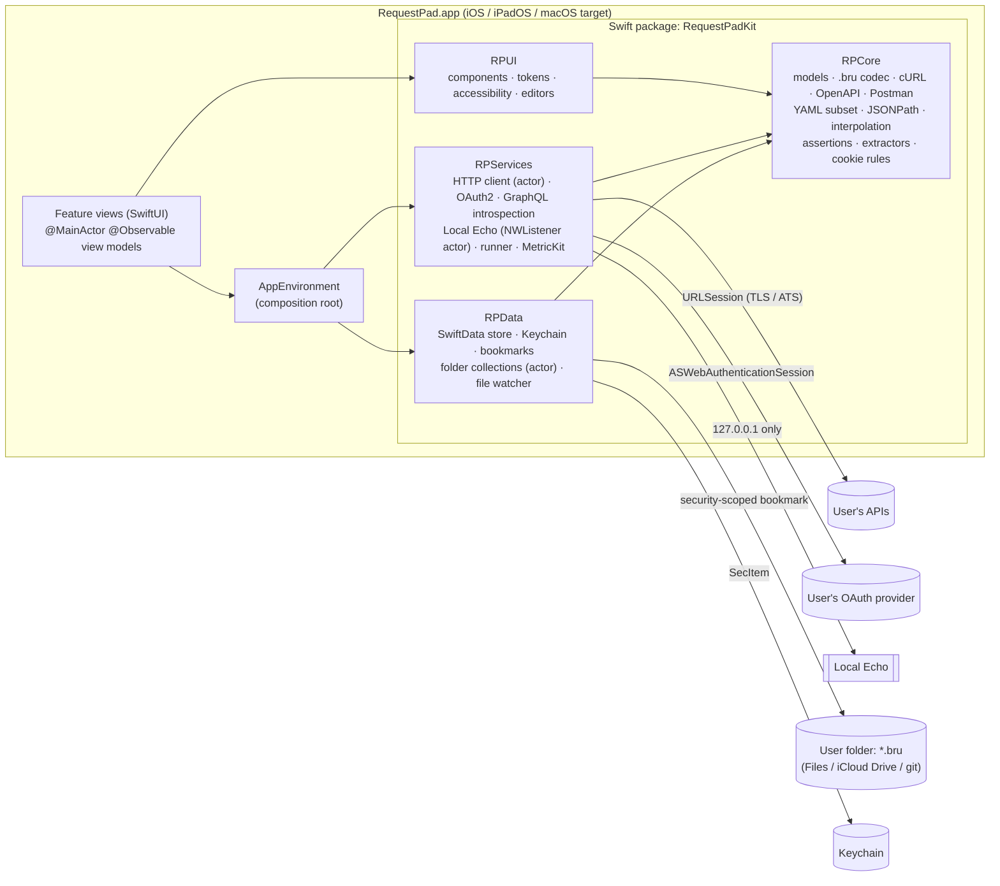
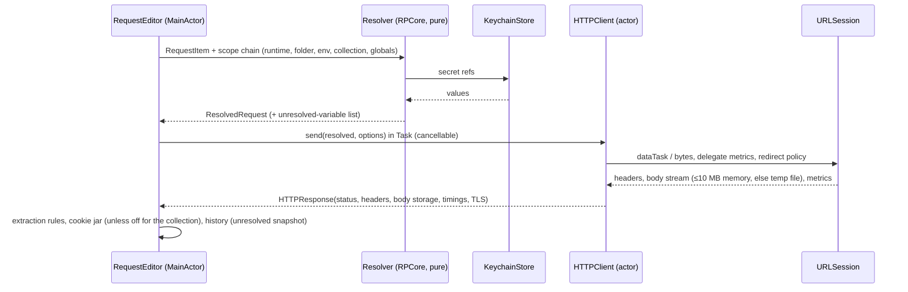

# RequestPad — Architecture

## 1. Overview

RequestPad is a native, offline-first HTTP/GraphQL client. There is no backend: every trust boundary is on the device
(app ↔ user's servers, app ↔ user's files, app ↔ Keychain).

## 2. Modules

| Module | Depends on | Contents | Frameworks allowed |
|---|---|---|---|
| `RPCore` | — | Value-type domain models (`Collection`, `RequestItem`, `Environment`, `Variable`, `Auth`, `Body`, `Extractor`, `Assertion`, `HistoryEntry`, `Cookie`), `.bru` lexer/parser/serializer, env-file codec, cURL parser/exporter, YAML subset parser, OpenAPI & Postman importers, JSONPath evaluator, `{{var}}` interpolator, assertion & extraction engine, RFC 6265 cookie matching, GraphQL lexer/introspection schema model/completion engine, PKCE helpers | Foundation, CryptoKit (SHA-256 only) |
| `RPData` | RPCore | SwiftData `SchemaV1` models + `SchemaMigrationPlan`, stores (upsert by natural key), `KeychainStore`, `BookmarkStore`, `FolderCollectionRepository` actor, file watcher, export/import, erase-all | SwiftData, Security, LocalAuthentication |
| `RPServices` | RPCore, RPData | `HTTPClient` actor (URLSession + delegate metrics/redirect/streaming), `OAuth2Service`, `GraphQLSchemaService`, `LocalEchoServer` actor (Network.framework), `CollectionRunner`, `DiagnosticsService`, `MetricsSubscriber` (MetricKit), `LocalNetworkPermissionProbe` | Foundation, Network, AuthenticationServices, MetricKit, OSLog |
| `RPUI` | RPCore | Design tokens, status badges, key-value table editor, code/text editors (`UITextView`/`NSTextView` representables for large text and GraphQL completion), JSON tree view, accessibility helpers | SwiftUI, UIKit/AppKit bridging only where needed |
| App target | all | `RequestPadApp`, scenes, feature views, App Intents, MenuBarExtra, Services provider, onboarding, settings | SwiftUI |

One Xcode app target builds for iOS/iPadOS and macOS (multiplatform, `SUPPORTED_PLATFORMS = iphoneos iphonesimulator
macosx`), which yields one bundle ID for Universal Purchase. The package lives at the repo root (`Package.swift`) and is
added to the supplied project as a local package (ADR-0003). The former `RPStore` module (StoreKit, entitlements,
feature gate) was removed with the move to a free app (ADR-0046).

## 3. Data model

### 3.1 Persistence split

| Data | Where | Why |
|---|---|---|
| Native collections, folders, requests, environments (non-secret values), globals, history, cookie jar, GraphQL schema cache, drafts, OAuth token metadata (not the token) | SwiftData (`SchemaV1`, local only, `cloudKitDatabase: .none`) | Structured, queryable, versioned |
| Folder collections | `.bru` files in the user's folder; an in-memory index + SwiftData `FolderCollectionRef` row holding the bookmark | Files are the source of truth — git-friendly |
| Secret variable values, OAuth access/refresh tokens, client secrets, Basic/Bearer/API-key literals when the user marks them secret | Keychain (`kSecClassGenericPassword`, service `lk.eonix.RequestPad`, `AfterFirstUnlockThisDeviceOnly`, not synchronizable) | B5 |
| Preferences (timeout, redirects, onboarding done, menu bar toggle, review counter) | `UserDefaults.standard` | No widgets → no app group (ADR-0006) |
| Large response bodies (> 10 MB) | Temp file in `FileManager.temporaryDirectory/Responses`, purged on launch and on Erase | Memory ceiling |
| MetricKit payloads | `Application Support/Diagnostics/*.json`, keep last 30 | B1 |

### 3.2 SwiftData `SchemaV1` models (B5 rules: all properties defaulted/optional, no `.unique`, optional relationships, no `.deny`)

| Model | Key fields | Natural key (for upsert) |
|---|---|---|
| `CollectionRecord` | `key`, `name`, `kind` (`native`/`folder`/`sample`), `bookmark: Data?`, `defaultHeadersJSON`, `authJSON`, `varsJSON`, `sortOrder`, `createdAt` | `key` = UUID string (native), `"folder:" + bookmark-resolved path hash` (folder) |
| `FolderRecord` | `key`, `collectionKey`, `parentKey?`, `name`, `sortOrder`, `varsJSON`, `authJSON` | `key` = UUID string |
| `RequestRecord` | `key`, `collectionKey`, `folderKey?`, `name`, `method`, `url`, `paramsJSON`, `headersJSON`, `bodyJSON`, `authJSON`, `extractorsJSON`, `assertionsJSON`, `settingsJSON`, `sortOrder`, `updatedAt` | `key` = UUID string |
| `EnvironmentRecord` | `key`, `collectionKey?` (nil = globals), `name`, `variablesJSON` (secret entries carry only a Keychain reference) | `key` = UUID string |
| `HistoryRecord` | `key`, `requestSnapshotJSON`, `status`, `durationMs`, `sizeBytes`, `contentType`, `sentAt`, `errorSummary?` | `key` = UUID string |
| `CookieRecord` | `key`, `name`, `value`, `domain`, `path`, `expiresAt?`, `secure`, `httpOnly`, `sameSite`, `hostOnly` | `key` = `domain|path|name` (RFC 6265 identity) |
| `SchemaCacheRecord` | `key`, `endpoint`, `schemaJSON`, `fetchedAt` | `key` = normalized endpoint URL |
| `DraftRecord` | `key`, `requestKey?`, `snapshotJSON`, `updatedAt` | `key` = tab identifier |

Nested value types (params, headers, body, auth, extractors, assertions) are stored as versioned JSON (`Codable` RPCore
structs) in `…JSON` properties. This keeps the SwiftData schema small and stable, and the same RPCore structs drive the
`.bru` codec, so native and folder collections share one editing model (ADR-0005). Every store with repeated writes
has a "same batch twice → same row count" test (B5).

## 4. Key flows

### 4.1 Send

### 4.2 Folder collection sync
`FolderCollectionRepository` (actor) resolves the bookmark, calls `startAccessingSecurityScopedResource()`, scans
`*.bru`, parses off-main, publishes an immutable `CollectionTree` snapshot. Writes serialize the RPCore model back to
`.bru`, merging into the original block list so unknown blocks/keys keep their original text, then write atomically
(`Data.write(options: .atomic)`; on iOS via `NSFileCoordinator` for File Provider/iCloud Drive). A
`DispatchSource` file-system watcher (per directory, macOS & iOS) debounces changes (250 ms) and diffs by file content
hash; our own writes are ignored by hash.

### 4.3 Purchases
None. The app is free with every feature included; there is no StoreKit code (ADR-0046).

## 5. Concurrency model

- Swift 6 language mode, `SWIFT_STRICT_CONCURRENCY = complete`, no `@unchecked Sendable` without a justification
  comment, no `DispatchQueue.main.async`.
- View models are `@MainActor @Observable`.
- Stateful services are actors: `HTTPClient`, `LocalEchoServer`, `FolderCollectionRepository`, `OAuth2Service`,
  `CollectionRunner`, `KeychainStore` (serializes SecItem mutations so delete-and-re-add is atomic).
- SwiftData: the UI uses the main `ModelContext`; background writes (history pruning, imports) use a `@ModelActor`.
- All RPCore types are `Sendable` value types; parsers are pure functions → safe to run from `Task.detached` for
  > 16 ms work.
- Cancellation: requests are started from `.task`/Task handles owned by the view model; closing a tab cancels its
  task; `URLSession` tasks are cancelled via `withTaskCancellationHandler`.
- `URLSessionDelegate` callbacks arrive on the session delegate queue; they are forwarded into the actor through
  `AsyncStream` continuations (Sendable), never touching actor state directly.

## 6. Networking rules

- `URLSession` with an ephemeral configuration per send (cookies applied manually from the RPCore jar,
  `httpShouldSetCookies = false`; none stored when the collection turns the jar off) so the OS never persists cookies
  or caches outside our control; `urlCache = nil`.
- Timeouts: per-request (default 30 s). Redirects handled in `willPerformHTTPRedirection` (follow/stop, max 10,
  `Authorization` stripped on cross-origin redirect).
- ATS stays on: no `NSAllowsArbitraryLoads`. `NSAllowsLocalNetworking = YES` plus `NSExceptionDomains` entries for
  loopback, RFC 1918 and link-local CIDR ranges allowing insecure HTTP loads (ADR-0010; iOS 17 / macOS 14 changed the
  IP-address default).
- No custom certificate trust, no `-k`.
- User-initiated requests are **never retried automatically** (an API client must show the real response; retrying
  POST is unsafe). Exponential backoff with jitter (B1) applies to app-initiated calls only: OAuth token refresh and
  GraphQL introspection, 3 attempts on 429/5xx honoring `Retry-After` (ADR-0007).

## 7. Threat model

### Assets
1. Secrets: secret variable values, OAuth tokens and client secrets, Bearer/Basic/API-key credentials.
2. User's API collections (may embed internal hostnames, sample payloads).
3. Response bodies (may contain PII from the user's systems).
4. The user's files in granted folders.

### Trust boundaries
App ↔ user's servers (network, untrusted responses) · App ↔ OAuth provider (browser session) · App ↔ files on disk /
iCloud Drive / git (untrusted input) · App ↔ imported documents (cURL, OpenAPI, Postman — untrusted) · App ↔ other
local processes (Local Echo port, URL scheme) · App ↔ Keychain.

### STRIDE-lite
| | Threat | Mitigation |
|---|---|---|
| Spoofing | Another app registers `requestpad://` and intercepts the OAuth code | PKCE S256 (code useless without verifier); `state` check; `ASWebAuthenticationSession` returns the callback directly to the session, not via the global URL scheme handler |
| Tampering | Malicious `.bru` / OpenAPI / Postman / cURL input crafted to crash or hang the parser | Hand-written parsers with size caps (10 MB docs, 1 MB per `.bru`), nesting depth caps (YAML/JSON 64, schema synthesis 8), YAML anchors/aliases limited (≤ 100 alias expansions, ADR-0014), no recursion on untrusted depth without a counter; fuzz tests |
| Tampering | Git pull replaces files while editing | Hash-based change detection + conflict prompt |
| Repudiation | N/A — single-user local app; history records what was sent | — |
| Info disclosure | Secrets written into `.bru` files and pushed to git | Secret vars are stored only in Keychain and serialized as `vars:secret [name]`; auth fields show a "Use a secret variable" hint when a literal token is typed in a folder collection |
| Info disclosure | Secrets in history, logs, diagnostics, crash reports, exports, cURL copy | History stores unresolved templates; `os.Logger` uses `.private` for all dynamic values and never logs headers/bodies; diagnostics redact to scheme+host; exports exclude secret values; cURL export masks secrets unless explicitly opted in |
| Info disclosure | Secrets shoulder-surfed | Masked by default; reveal requires biometrics/passcode (`LAContext`) |
| Info disclosure | `Authorization` leaked on redirect to another host | Stripped on cross-origin redirect |
| Info disclosure | Local Echo readable by other local processes | Bound to 127.0.0.1 only, off by default, only echoes what the caller sent, no state |
| DoS | Huge/slow response exhausts memory or freezes UI | Stream to disk above 10 MB, render cap, off-main parsing, cancellable, 30 s default timeout |
| DoS | Local Echo flooded | 16-connection cap, 20 MB request cap, 30 s idle timeout |
| Elevation | Paid features unlocked without paying | N/A — no purchases or gated features (ADR-0046) |
| Elevation | App reads files outside granted scope | App Sandbox + user-selected read-write + security-scoped bookmarks only |

### Highest-risk surfaces
1. **`.bru` read/write in user folders** — untrusted input *and* risk of corrupting the user's git-tracked files.
   Mitigation: lossless round-trip fixtures, preserve unknown text, atomic writes, never delete files the app did not
   create except on an explicit user Delete.
2. **Secret handling across UI/files/export/history** — a single leak path publishes credentials to git. Mitigation:
   one `SecretRef` type that cannot be serialized to text except through the Keychain resolver; tests that scan all
   serializers' output for secret fixtures.
3. **OAuth flow** — mitigated as above; tokens in Keychain; state machine unit-tested with a fake auth server.
4. **Importers** — fuzzed and size/depth-limited.

## 8. Error handling

Each module defines one `AppError`-style enum conforming to `LocalizedError` (`CoreError`, `DataError`,
`ServiceError`) with `errorDescription` + `recoverySuggestion`. Views render errors with retry / open
settings / contact support actions. No `try?` on user-initiated actions; no force unwraps or `try!` outside tests.

## 9. Observability (on-device only)

`os.Logger(subsystem: "lk.eonix.RequestPad", category: …)` with privacy annotations; MetricKit
`MXMetricManager` subscriber from launch persisting payloads locally; Export Diagnostics bundles redacted logs
(`OSLogStore(scope: .currentProcessIdentifier)`) + MetricKit summaries. Crash/hang review via Xcode Organizer. No
analytics, no third-party SDKs.

## 10. Build phases (B9, adapted)

| Phase | Deliverable | Exit evidence |
|---|---|---|
| 0 | PRD, Architecture (+ threat model), Decisions, SDLC log | Every feature has ≥ 1 AC |
| 1 | Repo layout, Package with 5 modules (RPStore removed in ADR-0046), project settings (Swift 6, targets, platforms), entitlements, Info.plist keys, privacy manifest, StoreKit config (removed in ADR-0046), String Catalog, scripts, CI, README/SECURITY/RUNBOOK skeleton content, placeholder lint | `scripts/test.sh` green; CI green |
| 2 | RPCore: models, `.bru` codec, env codec, interpolation, JSONPath, cURL, YAML subset, OpenAPI/Postman importers, assertions/extractors, cookies, GraphQL lexer/completion, PKCE | ≥ 80 % Core coverage; parse perf tests |
| 3 | RPData + RPServices: SwiftData stores, Keychain, bookmarks, folder repo + watcher, HTTP client, OAuth2, introspection, Local Echo, runner, diagnostics | Live + fake for every protocol; ASan/TSan clean |
| 4 | All UI, onboarding, settings, sample data, accessibility, localization | Accessibility-audit UI test on every screen |
| 5 | StoreKit 2, paywall, gating (removed in ADR-0046) | Purchase/restore/revocation tests (removed in ADR-0046) |
| 6 | App Intents, menu bar, Services, launch at login, state restoration | Each integration tested |
| 7 | Hardening, fuzzing, profiling, privacy report | TEST_PLAN all pass |
| 8 | Icon, screenshots, metadata, review notes | `docs/AppStore/*` complete |
| 9–11 | Human-gated: TestFlight, submission, post-launch | `docs/HUMAN_HANDOFF.md` |
